# DataCore AI — Enterprise SaaS

A multi-tenant SaaS business intelligence platform built with Next.js 15,
Supabase, Stripe, and Google Gemini. Features AI-powered insights, natural
language queries, role-based access control, team management, API keys,
audit logging, and subscription billing.

<p align="center">
  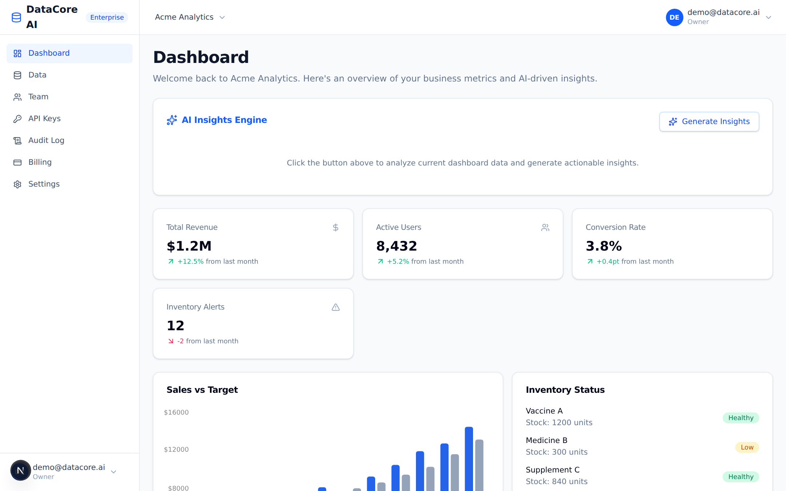
</p>

## Screenshots

| | |
|---|---|
| **Landing page** — public marketing site with feature grid and pricing | **Sign in** — email/password plus Google & GitHub SSO |
| 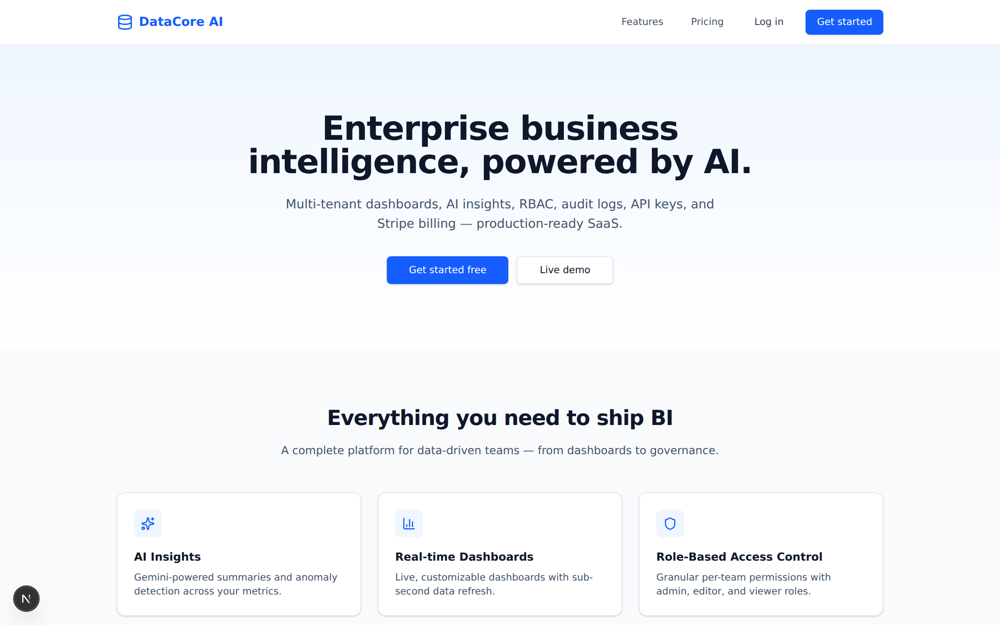 | 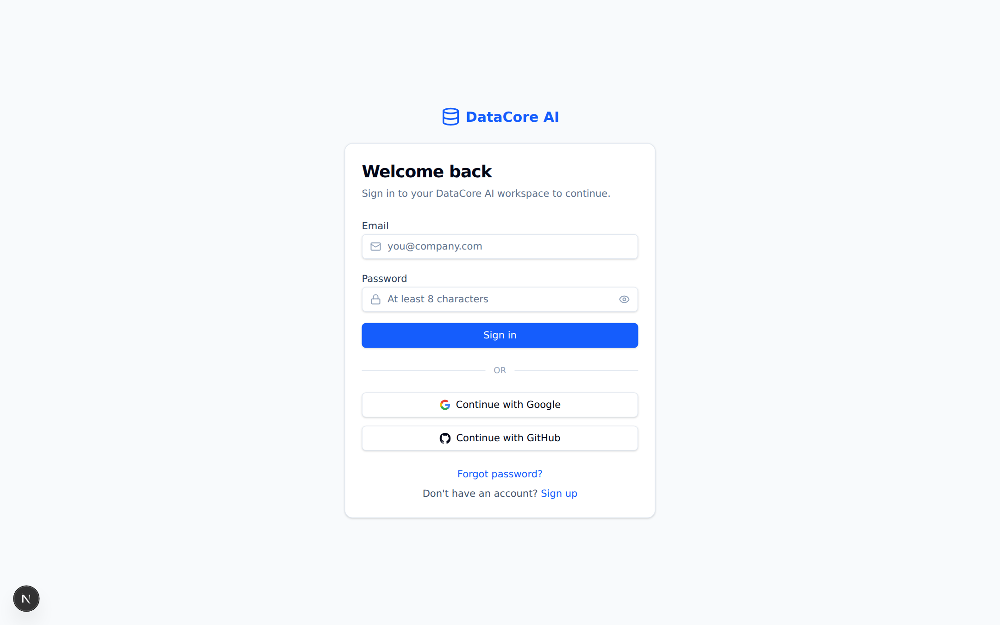 |
| **Features section** — AI, dashboards, RBAC, billing highlights | **Pricing** — Free / Pro / Enterprise plans |
| 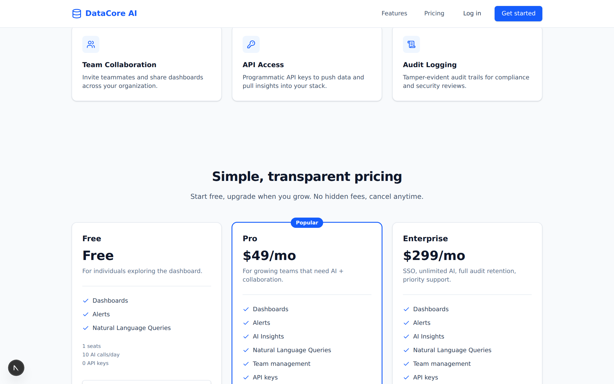 | 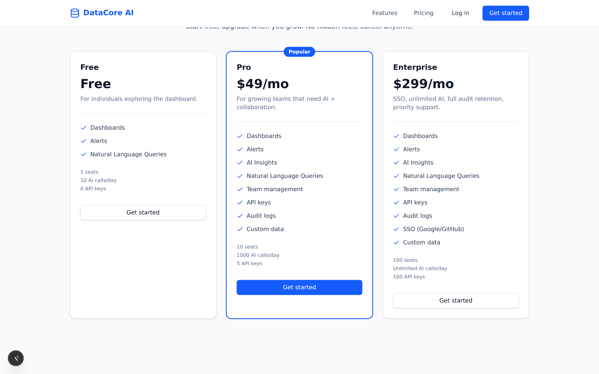 |
| **Onboarding** — create your first organization | **Choose an organization** — multi-workspace picker |
| 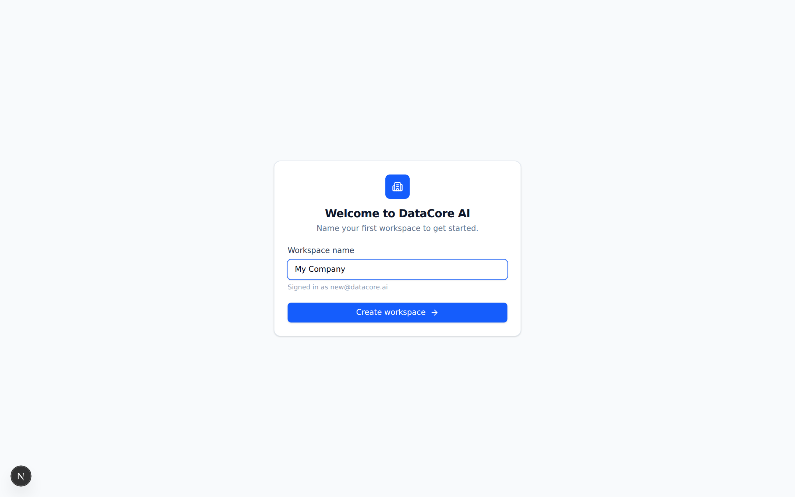 | 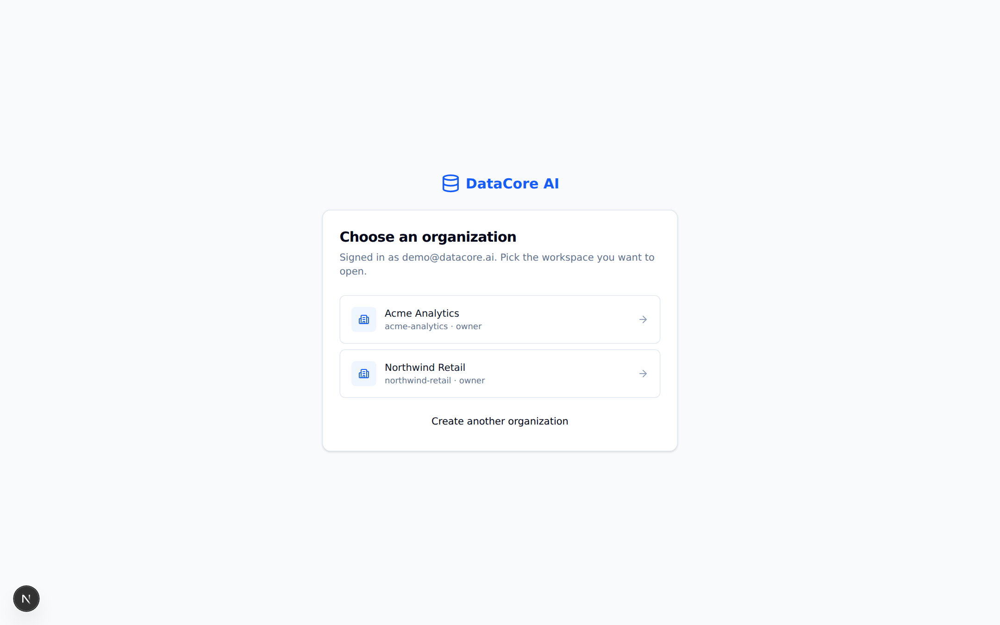 |
| **KPI cards** — revenue, users, conversion, alerts with trends | **Sales vs Target** — monthly Recharts comparison |
| 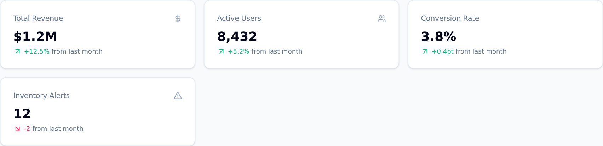 | 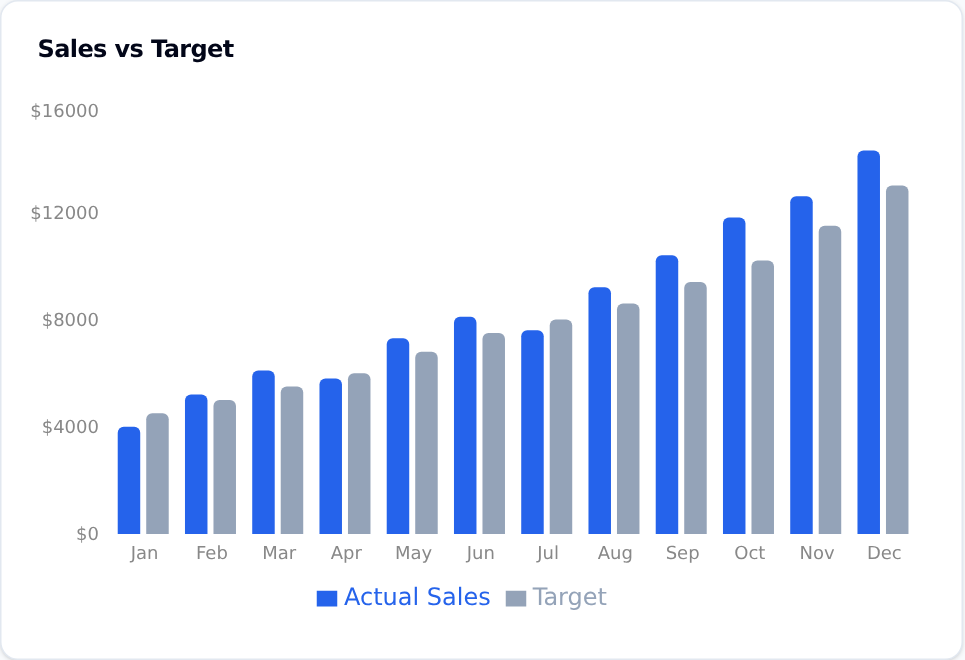 |
| **Inventory status** — stock levels with health badges | **AI Insights Engine** — Gemini analysis of live data (Pro+) |
| 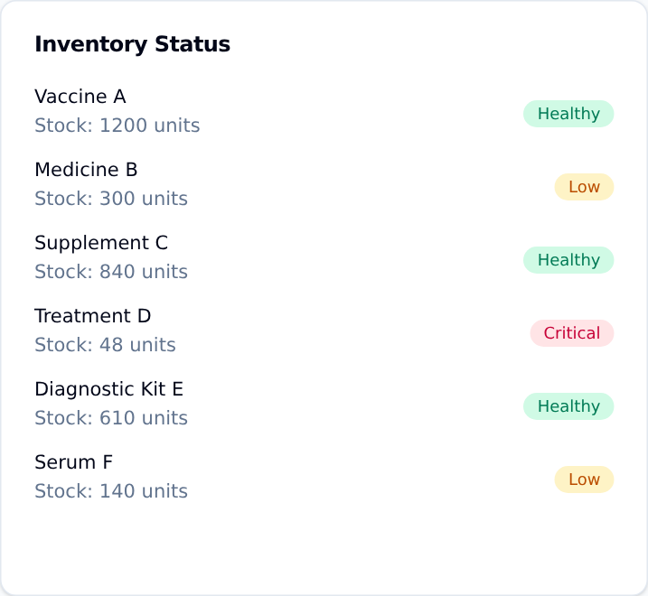 | 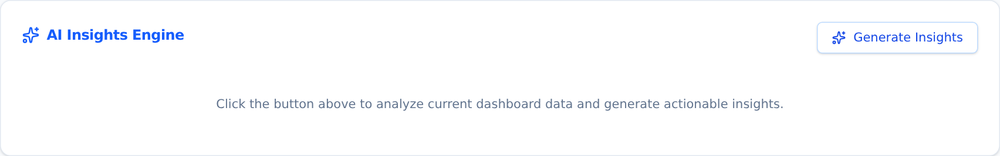 |
| **Team management** — members, roles, pending invitations | **API keys** — hashed keys with usage tracking |
| 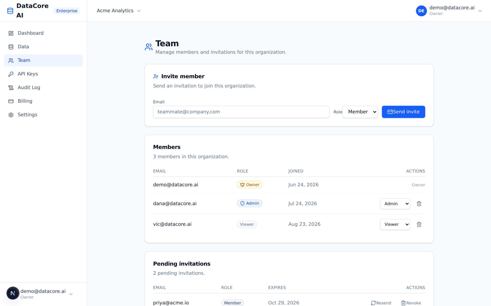 | 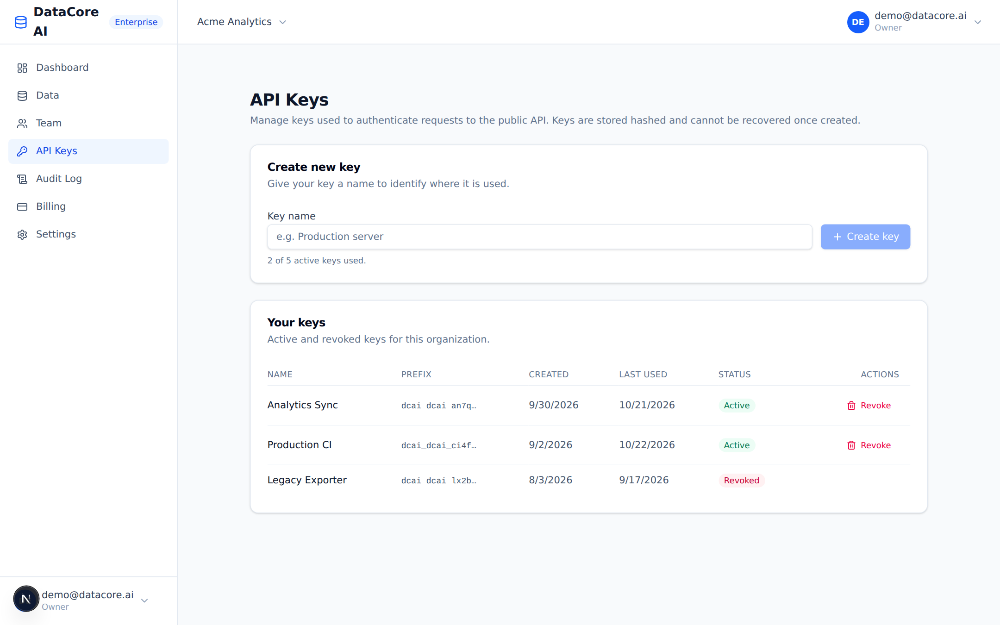 |
| **Audit log** — filterable, paginated activity trail | **Billing** — current plan, limits, and plan comparison |
| 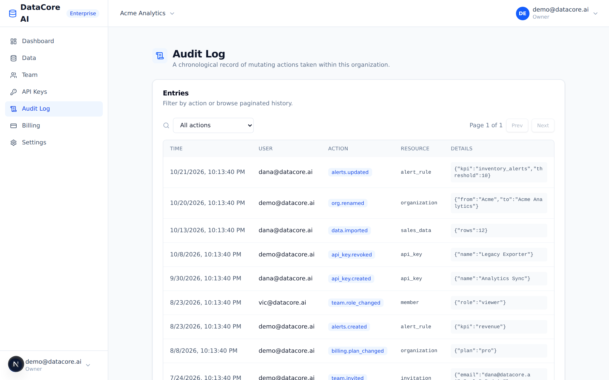 | 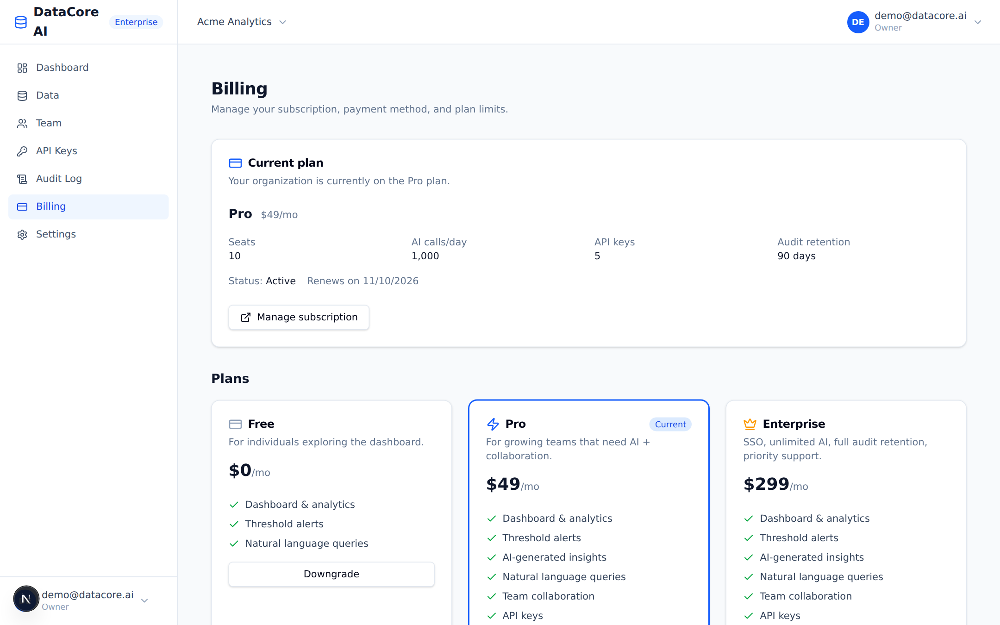 |
| **Data management** — CSV import, export, templates, history | **Alert rules** — threshold monitors with Slack/email delivery |
| 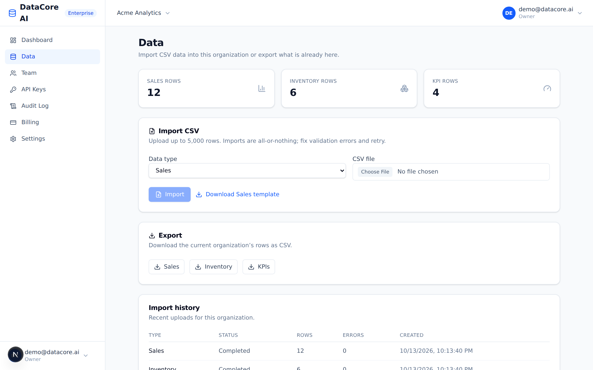 | 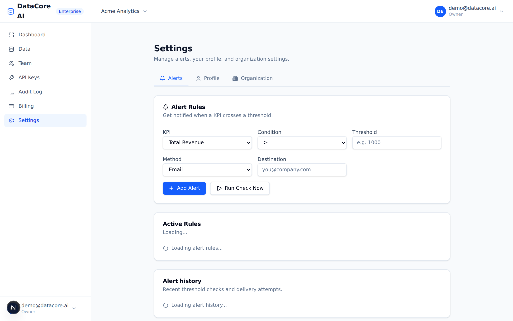 |

More in [`docs/screenshots/`](docs/screenshots): signup, password reset,
natural-language query chat, the org switcher dropdown, and the free-plan
dashboard showing upgrade prompts and the empty-data state.

## Overview

DataCore AI is a production-ready SaaS application that transforms the
single-user demo dashboard into a full enterprise product with:

- **Multi-tenant organizations** with Postgres Row-Level Security isolation
- **Authentication** via Supabase Auth (email/password + Google/GitHub SSO)
- **RBAC** with four roles: Owner, Admin, Member, Viewer
- **Stripe billing** with Free / Pro / Enterprise plans and feature gating
- **Team management** with email invitations and role assignment
- **API keys** with hashed storage and usage metering
- **Audit logging** of every mutating action
- **AI insights** and natural language queries (Gemini) with plan-based limits
- **Security hardening**: CSP headers, CSRF protection, rate limiting,
  input validation, HTML sanitization, httpOnly cookies

## Tech Stack

| Category | Technology |
|----------|------------|
| Framework | Next.js 15 (App Router) |
| Language | TypeScript |
| UI | React 19, Tailwind CSS v4 |
| Database/Auth | Supabase (Postgres + RLS + Auth) |
| Billing | Stripe (Subscriptions + Customer Portal) |
| AI | Google Gemini |
| Charts | Recharts |
| Validation | Zod |

## Quick Start

### Prerequisites

- Node.js 18+
- npm
- Supabase project (for auth + multi-tenant data)
- Stripe account (for billing)
- Google Gemini API key (for AI features)

### Installation

```bash
git clone <repository-url>
cd AI-Enabled-Business-Dashboard
npm install
```

### Environment Variables

Copy `.env.example` to `.env.local` and fill in:

```bash
# Supabase
NEXT_PUBLIC_SUPABASE_URL=your_supabase_url
NEXT_PUBLIC_SUPABASE_ANON_KEY=your_supabase_anon_key
SUPABASE_SERVICE_ROLE_KEY=your_service_role_key  # server-only, never expose

# Google Gemini (server-only; NEXT_PUBLIC_ is kept for backwards compatibility)
GEMINI_API_KEY=your_gemini_api_key
NEXT_PUBLIC_GEMINI_API_KEY=your_gemini_api_key

# Stripe
STRIPE_SECRET_KEY=sk_test_xxx
NEXT_PUBLIC_STRIPE_PUBLISHABLE_KEY=pk_test_xxx
STRIPE_WEBHOOK_SECRET=whsec_xxx
STRIPE_PRICE_PRO=price_xxx       # Stripe price ID for Pro plan
STRIPE_PRICE_ENTERPRISE=price_xxx # Stripe price ID for Enterprise plan

# App URL (for Stripe redirects)
NEXT_PUBLIC_APP_URL=http://localhost:3000

# Background alert evaluation
CRON_SECRET=replace-with-a-long-random-secret

# Optional email relay for alert notifications (POST JSON {to,subject,text,...})
ALERT_EMAIL_WEBHOOK_URL=
```

### Database Setup

Run the migration against your Supabase project:

```bash
# Using Supabase CLI
supabase db push

# Or manually: run the migrations in order in the Supabase SQL Editor:
#   supabase/migrations/0000_base.sql
#   supabase/migrations/0001_enterprise.sql
#   supabase/migrations/0002_security_and_features.sql
```

This creates:
- base tables for sales, inventory, KPIs, and alert rules
- `organizations`, `organization_members`, `organization_invitations`
- `audit_logs`, `api_keys`, `usage_events`, `feature_flags`
- `data_sources`, `import_jobs`, `alert_events`, `ai_conversations`, `ai_messages`, `stripe_events`
- Adds `org_id` columns to existing `sales_data`, `inventory_data`, `kpis`, `alert_rules`
- Enables Row-Level Security on all tables with org-scoped policies

`0002_security_and_features.sql` hardens the 0001 policies: organization
renames are owner-only, API keys and audit logs require owner/admin, viewers
are read-only, and AI conversations are visible only to their author.

#### Generated TypeScript types

`lib/supabase/types.ts` is generated from the migrations and typed into every
Supabase client (`lib/supabase/client.ts`, `server.ts`, `admin.ts`), so queries,
inserts, and nested selects are checked against the real schema. Regenerate it
after changing a migration (requires the local stack to be running):

```bash
supabase start
npm run db:types
```

`lib/supabase/rows.ts` re-exports short row aliases (`SalesRow`, `KpiRow`, …)
for the rest of the app; components use those instead of local `any` props.

#### Verifying the database layer

`supabase/tests/rls.sql` seeds two tenants and asserts tenant isolation and role
boundaries as the `authenticated` role. It runs in a transaction that is rolled
back, so it is safe to run against any database that has the migrations applied:

```bash
psql "$DATABASE_URL" -v ON_ERROR_STOP=1 -f supabase/tests/rls.sql
```

CI runs the migrations on a clean Supabase Postgres image and then runs this
suite, so a broken migration or a missing policy fails the build.

### Stripe Setup

1. Create products + prices in Stripe Dashboard for Pro ($49/mo) and Enterprise ($299/mo)
2. Copy the price IDs into `STRIPE_PRICE_PRO` and `STRIPE_PRICE_ENTERPRISE`
3. Register a webhook endpoint pointing to `https://yourdomain.com/api/billing/webhook`
   for events: `checkout.session.completed`, `customer.subscription.updated`,
   `customer.subscription.deleted`, `invoice.paid`
4. Copy the webhook signing secret into `STRIPE_WEBHOOK_SECRET`

For local development, use the Stripe CLI to forward webhooks:

```bash
stripe listen --forward-to localhost:3000/api/billing/webhook
```

### Enable SSO (Optional)

In Supabase Dashboard → Authentication → Providers:
- Enable Google and/or GitHub
- Add the OAuth client IDs/secrets from each provider
- Set the redirect URL to `https://yourdomain.com/auth/v1/callback`

### Run

```bash
npm run dev
```

Navigate to [http://localhost:3000](http://localhost:3000)

### Running without a Supabase project (mock backend)

For quick UI development or screenshot capture on machines that can't run
the Supabase Docker stack, a small in-memory mock of the Auth + PostgREST
APIs ships with the repo:

```bash
node scripts/mock-supabase.mjs   # listens on http://127.0.0.1:54321
npm run dev
```

Point `NEXT_PUBLIC_SUPABASE_URL` at `http://127.0.0.1:54321` (any
placeholder keys work). The mock seeds two demo organizations — a Pro org
with a full year of data (`demo@datacore.ai` / `Screenshots123!`) and an
empty free org — plus onboarding, team, audit, API-key, and billing demo
records. The CSP in `next.config.ts` automatically allows the configured
non-`supabase.co` origin, so the browser talks to it directly.

The README screenshots are generated by `node scripts/capture-screenshots.mjs`
(headless Playwright) against this mock.

## Features

### Authentication
- Email/password signup and login
- Google and GitHub OAuth SSO
- Password reset flow
- Email-based team invitations with token acceptance

### Multi-Tenancy
- Each user can belong to multiple organizations
- Org switcher in the header
- All data is isolated by `org_id` with Postgres RLS enforcement
- New users create their first org during onboarding

### Role-Based Access Control

| Permission | Owner | Admin | Member | Viewer |
|------------|-------|-------|--------|--------|
| View dashboard | ✓ | ✓ | ✓ | ✓ |
| Use AI features | ✓ | ✓ | ✓ | — |
| Manage alerts | ✓ | ✓ | ✓ | — |
| Manage team | ✓ | ✓ | — | — |
| Manage API keys | ✓ | ✓ | — | — |
| View audit log | ✓ | ✓ | — | — |
| Manage billing | ✓ | — | — | — |
| Manage org | ✓ | — | — | — |

### Billing Plans

| Feature | Free | Pro ($49/mo) | Enterprise ($299/mo) |
|---------|------|-------------|----------------------|
| Seats | 1 | 10 | 100 |
| AI calls/day | 10 | 1,000 | Unlimited |
| API keys | 0 | 5 | 100 |
| Audit retention | 7 days | 90 days | 1 year+ |
| AI Insights | — | ✓ | ✓ |
| Team management | — | ✓ | ✓ |
| API access | — | ✓ | ✓ |
| Audit logs | — | ✓ | ✓ |
| SSO | — | — | ✓ |

### Dashboard
- KPI cards with trend indicators
- Sales vs target charts
- Inventory status table
- AI Insights engine (Pro+)
- Natural language query chat
- Explicit empty states instead of cross-tenant mock fallbacks
- All data scoped to the active organization

<p align="center">
  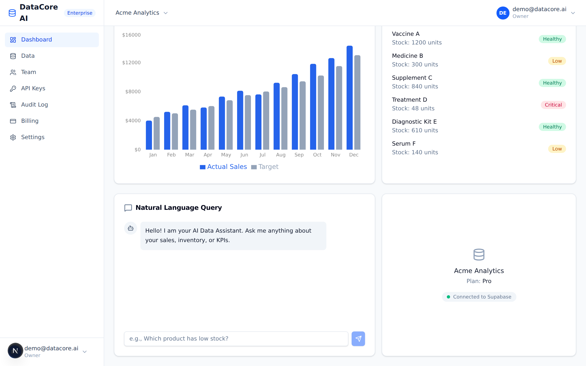
</p>

Free-plan organizations see upgrade prompts in place of AI features, and new
organizations see a "No data yet" banner with a direct link to import:

<p align="center">
  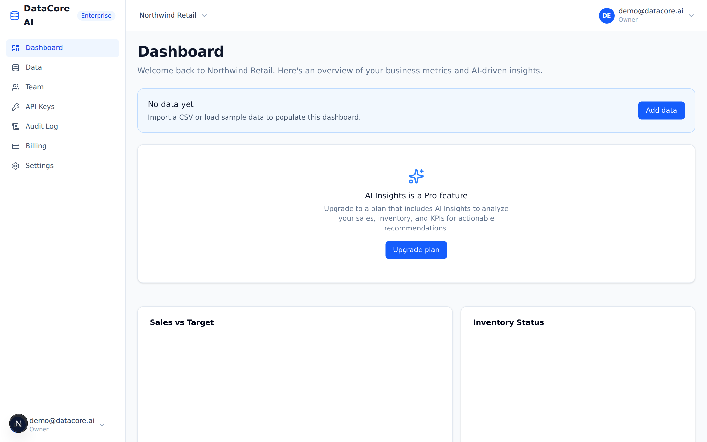
</p>

### Data Management
- CSV import for sales, inventory, and KPIs
- Row-level validation with all-or-nothing imports
- CSV templates and exports
- Import history
- Explicit "load sample data" action for new organizations

### Alerts
- Per-org threshold rules for revenue, inventory alerts, active users, or named KPIs
- Manual "Run Check Now" evaluation
- Cooldown-based deduplication
- Slack incoming-webhook delivery
- Email delivery through an operator-configured relay
- Alert event history with delivery status
- Secret-protected cron endpoint at `/api/cron/alerts`

### Team Management
- Invite members by email
- Assign Admin/Member/Viewer roles
- Revoke pending invitations
- Remove members
- Seat limits enforced per plan

### API Keys
- Generate keys with `dcai_` prefix
- Plaintext shown once; stored as SHA-256 hash
- Revoke keys (retained for audit)
- Use keys to access the public API at `/api/v1/*`

### Public API

```bash
# Get org metrics
curl https://yourdomain.com/api/v1/metrics \
  -H "Authorization: Bearer dcai_xxx"

# Ask an AI question
curl -X POST https://yourdomain.com/api/v1/insights \
  -H "Authorization: Bearer dcai_xxx" \
  -H "Content-Type: application/json" \
  -d '{"question":"Which products have low stock?"}'
```

### Audit Logging
Every mutating action is recorded: alert changes, team changes, API key
creation/revocation, billing changes, org creation/rename. Viewable by
admins with filtering and pagination.

## Security

This application implements defense-in-depth:

- **Auth cookies**: httpOnly, SameSite=Lax, refreshed via middleware
- **Row-Level Security**: every tenant-scoped query is enforced by Postgres RLS
- **CSRF protection**: custom header check on all mutating routes
- **Rate limiting**: IP-based limits on auth, AI, and public API routes
- **Input validation**: Zod schemas on every API route
- **HTML sanitization**: AI output is sanitized before rendering
- **Security headers**: CSP, HSTS, X-Frame-Options, X-Content-Type-Options,
  Referrer-Policy, Permissions-Policy
- **API key hashing**: SHA-256, never stored in plaintext
- **Secret isolation**: service role key and Stripe secret are server-only
- **Audit trail**: immutable log of all privileged actions

> **Note**: No application is "100% secure." These measures significantly
> reduce attack surface, but regular dependency updates (`npm audit`),
> penetration testing, and monitoring are essential for production.

## Codebase Structure

```
AI-Enabled-Business-Dashboard/
├── app/
│   ├── (auth)/                 # Auth route group (login, signup, etc.)
│   │   ├── login/
│   │   ├── signup/
│   │   ├── forgot-password/
│   │   ├── reset-password/
│   │   ├── accept-invite/[token]/
│   │   └── layout.tsx
│   ├── (app)/                  # Authenticated app route group
│   │   ├── dashboard/
│   │   ├── team/
│   │   ├── api-keys/
│   │   ├── audit/
│   │   ├── billing/
│   │   ├── settings/
│   │   └── layout.tsx          # App shell with sidebar + header
│   ├── (marketing)/            # Public landing page
│   │   ├── page.tsx
│   │   └── layout.tsx
│   ├── onboarding/             # First-org creation
│   ├── api/
│   │   ├── chat/               # AI NLQ (auth + rate limited)
│   │   ├── insights/           # AI insights (auth + rate limited)
│   │   ├── org/                # Org list + create + switch
│   │   ├── team/               # Invite, accept, update, revoke
│   │   ├── api-keys/           # Create + revoke
│   │   ├── audit/              # Audit log ingestion
│   │   ├── billing/            # Checkout, portal, webhook
│   │   └── v1/                 # Public API (API key auth)
│   │       ├── metrics/
│   │       └── insights/
│   ├── layout.tsx              # Root layout (ToastProvider)
│   └── globals.css
├── components/
│   ├── app/                    # Sidebar, org switcher, user menu
│   ├── auth/                   # AuthForm
│   ├── dashboard/              # KpiCards, SalesChart, etc.
│   ├── providers/              # OrgProvider
│   └── ui/                     # Button, Card, Input, Toast, Markdown
├── lib/
│   ├── auth/                   # rbac, roles, requireOrg, apiKeyAuth
│   ├── billing/                # plans, limits, stripe
│   ├── security/               # rate-limit, csrf, sanitize
│   ├── supabase/               # server, client, admin
│   ├── audit/                  # log
│   ├── utils/                  # markdown
│   ├── mock-data.ts
│   ├── usage.ts
│   └── utils.ts
├── supabase/
│   ├── migrations/
│   │   ├── 0000_base.sql
│   │   ├── 0001_enterprise.sql
│   │   └── 0002_security_and_features.sql
│   └── tests/
│       └── rls.sql                   # tenant-isolation assertions
├── scripts/
│   ├── mock-supabase.mjs             # in-memory Auth+REST mock for local dev
│   ├── capture-screenshots.mjs       # Playwright README screenshot runner
│   └── recapture-closeups.mjs        # dashboard element close-ups
├── docs/
│   └── screenshots/                  # README screenshots (regenerated)
├── middleware.ts               # Auth guard + session refresh
├── next.config.ts              # Security headers (CSP allows self-hosted Supabase origins)
└── package.json
```

## Verification

```bash
npm run lint       # ESLint
npm run typecheck  # TypeScript
npm test           # Vitest unit tests
npm run build      # Production build
```

## License

Private and proprietary. All rights reserved.

---

Built with Next.js, Supabase, Stripe, and Google Gemini.
